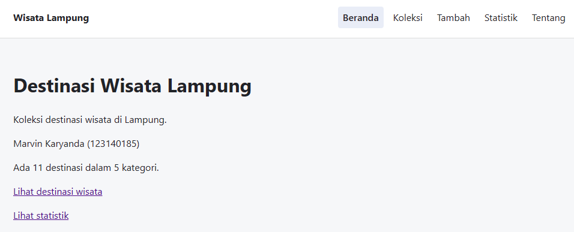
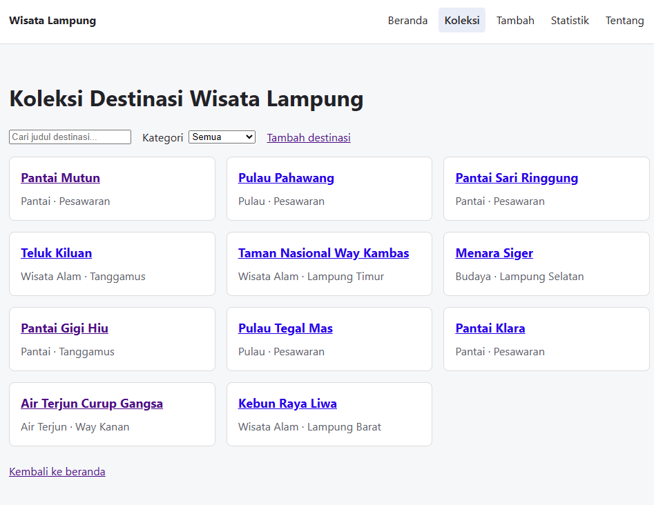

# Destinasi Wisata Lampung

Aplikasi sederhana untuk melihat dan mengelola daftar destinasi wisata di Lampung. Proyek ini dibuat untuk UTS Pengembangan Aplikasi Web.

## Identitas

- Nama: Marvin Karyanda
- NIM: 123140185
- Kelas: RA
- Tema: Destinasi Wisata Lampung

## Tautan

- Deployment: [Buka aplikasi](https://72knvm.github.io/uts-paw/)
- [Repo GitHub](https://github.com/72knvm/uts-paw)

## Fitur

- Beranda dengan jumlah destinasi dan kategori.
- Daftar koleksi wisata dengan pencarian judul dan filter kategori.
- Detail wisata berisi kategori, kabupaten/kota, harga tiket, dan jam buka.
- Form tambah wisata dengan validasi judul dan harga tiket.
- Hapus wisata dengan konfirmasi.
- Statistik jumlah destinasi per kategori dan totalnya.
- Halaman Tentang berisi identitas dan tautan repo.
- Halaman 404 untuk alamat yang tidak tersedia.
- Navigasi bersama dan tampilan responsif.

## Teknologi

- React dan Vite.
- React Router untuk perpindahan halaman.
- Context API untuk berbagi data koleksi.
- localStorage untuk menyimpan perubahan data di browser.
- Vitest dan React Testing Library untuk pengujian.
- Oxlint untuk pemeriksaan kode.

## Menjalankan secara lokal

Gunakan Node.js 22 dan npm. Dari folder utama proyek, jalankan:

```bash
cd app
npm ci
npm run dev
```

Buka alamat localhost yang muncul di terminal.

## Memeriksa aplikasi

Jalankan perintah berikut dari folder `app`:

```bash
npm run lint
npm test
npm run build
```

Untuk melihat hasil build secara lokal:

```bash
npm run preview
```

## Konsep React yang dipakai

- Komponen fungsional dan props.
- `useState` dan `useEffect`.
- Context API dengan `createContext`, Provider, dan `useContext`.
- Custom hook `useKoleksi` dan `useLocalStorage`.
- `NavLink`, `Link`, `useParams`, dan `useNavigate`.
- Form terkontrol, rendering bersyarat, dan daftar dengan `map` serta `key`.
- Pengambilan data dengan `fetch` dan `async/await`.

## Penyimpanan data

Data awal berisi 10 destinasi dan disimpan di `app/public/data/koleksi.json`. Setelah dimuat, koleksi disimpan ke localStorage. Data yang ditambah atau dihapus tetap tersimpan setelah refresh pada browser dan perangkat yang sama.

## Tangkapan layar

### Beranda



### Koleksi


